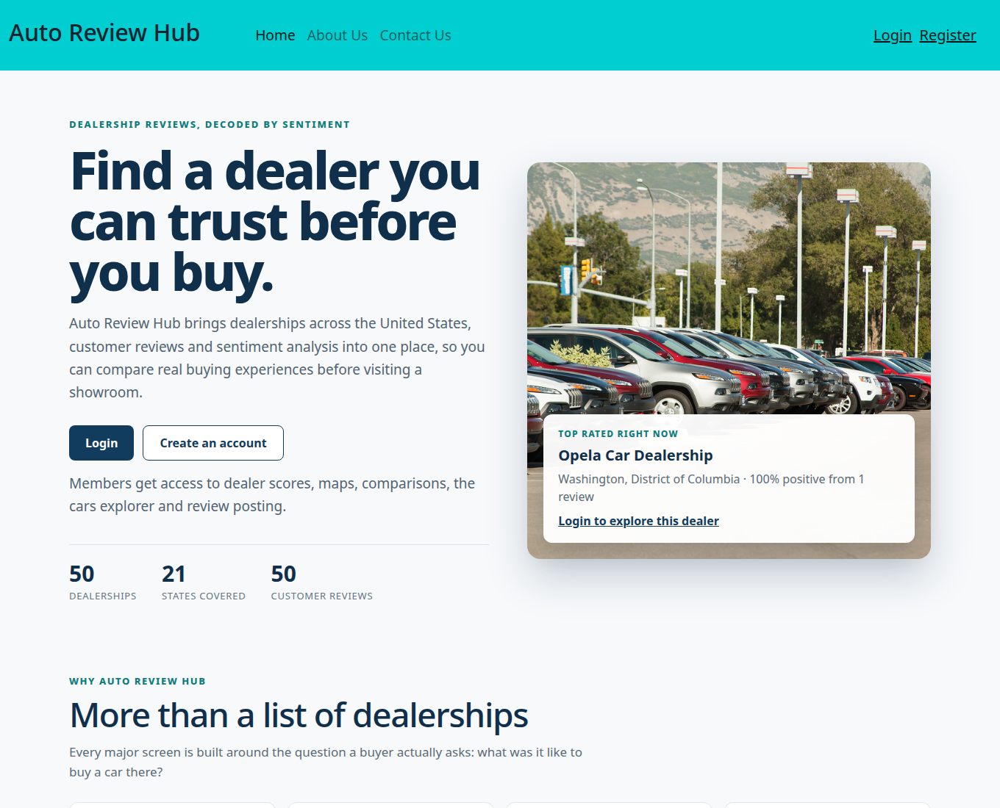
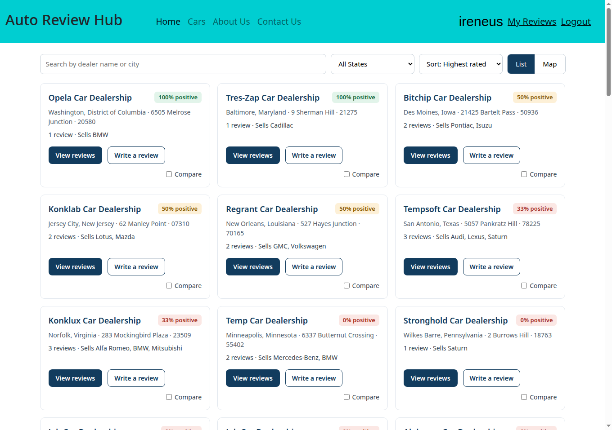
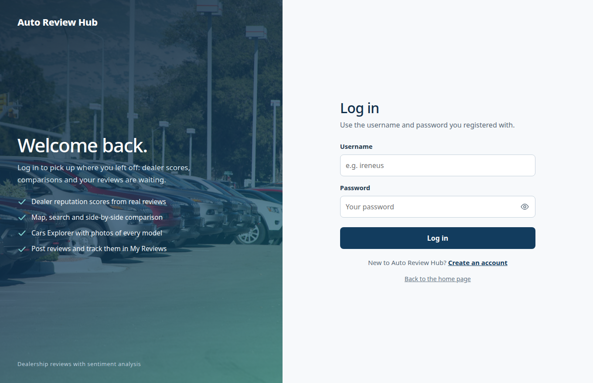
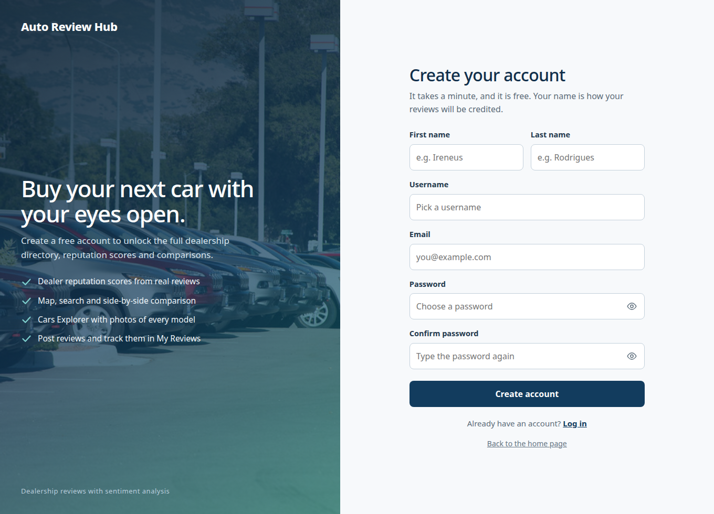
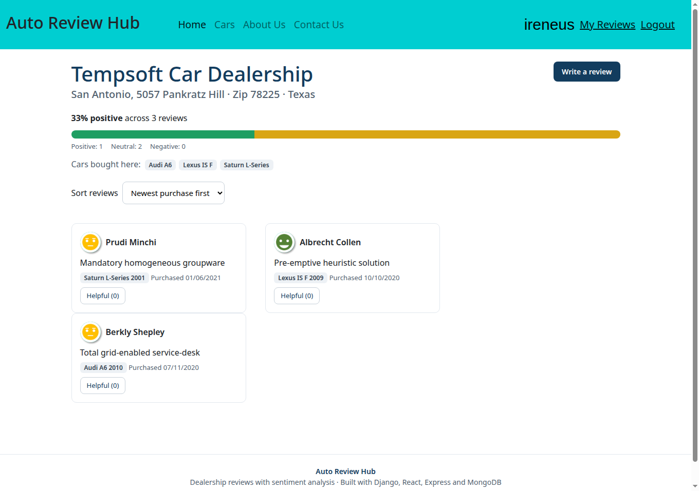
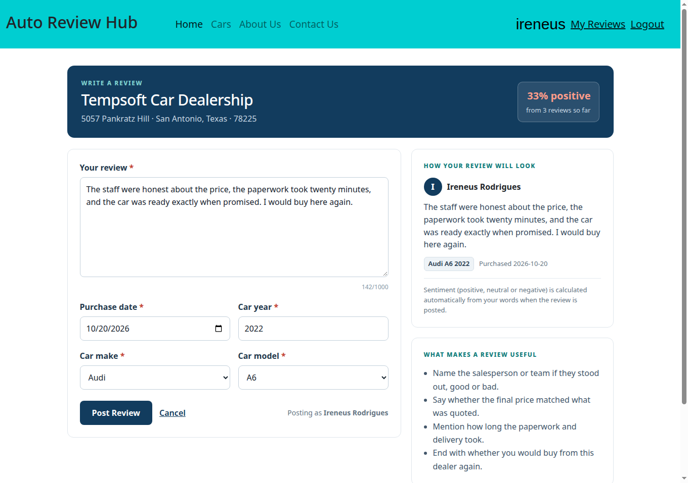
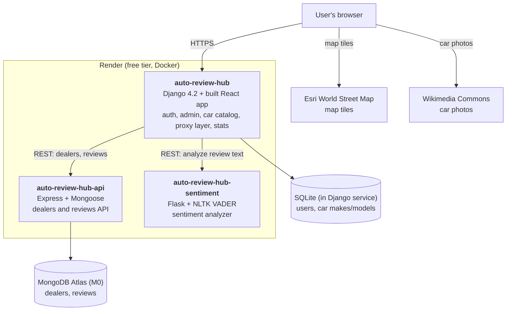
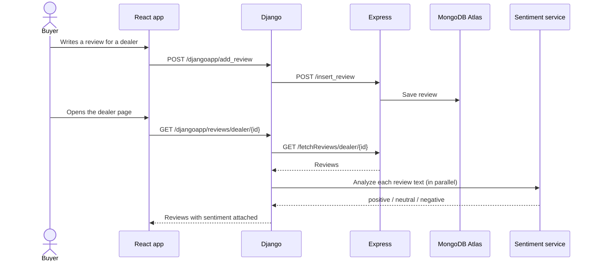

# Auto Review Hub

A full-stack car dealership review platform for the United States. Buyers
browse dealerships, read customer reviews scored by sentiment analysis,
compare dealers side by side, and post their own reviews as registered
users.

**Live demo: [auto-review-hub.onrender.com](https://auto-review-hub.onrender.com)**


Built as the capstone project for the **IBM Full Stack Application
Development** program, then extended well beyond the course scope
(reputation scoring, maps, dealer comparison, a landing page with an
account gate, a Cars Explorer with photos, and a full UI redesign).

> **Demo note:** the app runs on free tiers. Services sleep after about
> 15 minutes idle and take 30 to 60 seconds to wake on the first request.
> Register a free account to enter the app; the directory, reviews and
> tools are member-only by design.

## Screenshots

| Landing page | Dealers directory |
| --- | --- |
|  |  |

| Login | Register |
| --- | --- |
|  |  |

| Dealer detail with sentiment breakdown | Write a review |
| --- | --- |
|  |  |

## Features

**Discover dealerships**

- Public landing page with live platform counters and a top-rated
  dealer spotlight computed from real review data
- Dealer directory as cards with a reputation score badge
  (percentage of positive reviews) on every dealer
- Search by dealer name or city, filter by state, sort by highest
  rated, most reviewed, or name
- Map view plotting every dealer from its stored latitude/longitude
  (Leaflet with Esri World Street Map tiles)
- Compare up to three dealers side by side: score, review counts,
  sentiment split, top car makes sold

**Reviews and sentiment**

- Every review is scored positive, neutral, or negative by a dedicated
  sentiment service (NLTK VADER)
- Dealer pages show a sentiment breakdown bar, the cars bought at that
  dealer, and review sorting (newest, oldest, most helpful)
- Helpful votes on reviews
- Write-a-review composer with a live preview of exactly how the
  review will render, dependent make/model dropdowns, and the dealer's
  current score shown while you write
- Reputation scores are computed from all reviews by a stats endpoint
  with parallel sentiment calls and a 5-minute cache

**Cars**

- Cars Explorer: every catalog model as a photo card, the photo matched
  to the exact model (sourced from Wikipedia/Wikimedia Commons), with
  per-model review counts and positive percentage, plus make/model
  search

**Accounts**

- Designed split-screen login and register pages with show/hide
  password toggles and inline error messages (no browser alerts)
- After login you land directly in the dealer directory; the app
  screens are gated to members in the UI
- My Reviews page listing everything you have posted, with sentiment
- Django Admin for managing users and the car catalog, with
  non-interactive superuser creation on deploy

## Architecture

Three services plus a managed database. Django is the only public entry
point: it serves the built React app and proxies all data access, so the
browser never talks to the Express or sentiment services directly.



### How a review flows



### Design decisions worth knowing

- **Django is the proxy and the product layer.** `restapis.py` calls the
  Express and sentiment services; `views.py` adds what the raw data
  cannot express: per-dealer reputation stats (`dealer_stats`), the
  caller's own reviews (`my_reviews`), and helpful-vote proxying.
- **Scores are computed, never stored.** A dealer's score is the share
  of positive reviews right now, so posting or voting changes it
  immediately. Stats responses are cached for 5 minutes because a full
  computation re-analyzes every review.
- **Sentiment is a separate service** (a course requirement, and a
  genuinely clean boundary): Flask + VADER, designed for IBM Code
  Engine, running here as its own Docker service. It works fully
  offline; the VADER lexicon ships in the image.
- **Two databases on purpose.** Users and the car catalog live in
  Django's relational store (they are admin-managed, relational data).
  Dealers and reviews live in MongoDB behind Express (the course's
  document-store service).

## Tech stack

| Layer | Technology |
| --- | --- |
| Frontend | React 18, React Router, Leaflet (react-leaflet), Bootstrap |
| Web / API gateway | Django 4.2, WhiteNoise, Gunicorn |
| Dealer/review service | Node.js, Express, Mongoose |
| Database | MongoDB Atlas (dealers, reviews), SQLite (users, cars) |
| Sentiment | Flask, NLTK VADER |
| Packaging | Docker (three images), Docker Compose for local data services |
| Hosting | Render Blueprint (`render.yaml`), free tier |
| CI | GitHub Actions: flake8 + jshint lint, React build + Django checks |
| Also included | Kubernetes manifests for the Django app (`server/deployment.yaml`, `server/service.yaml`) |

## Project structure

```
.
├── render.yaml                  Render Blueprint: the three services
├── DEPLOYMENT.md                Deployment guide (Render + Atlas)
├── docs/screenshots/            Screenshots used in this README
└── server/
    ├── Dockerfile               Django image (builds the React app inside)
    ├── entrypoint.sh            Migrate, collectstatic, create superuser
    ├── djangoproj/              Project settings and root URLs
    ├── djangoapp/
    │   ├── views.py             Auth, proxies, stats, my reviews, helpful
    │   ├── restapis.py          Express + sentiment service clients
    │   ├── models.py            CarMake, CarModel
    │   ├── populate.py          Car catalog seed (15 models, 5 makes)
    │   └── microservices/       Flask sentiment analyzer (+ Dockerfile)
    ├── database/                Express + Mongoose service
    │   ├── app.js               Dealer/review endpoints, seeding
    │   └── data/                50 dealers and their seed reviews
    └── frontend/                React app
        ├── src/components/      Dealers, Dealer, PostReview, Cars,
        │                        Landing, Login, Register, MyReviews,
        │                        Header, Toast, Auth
        └── static/              About/Contact pages and site assets
```

## API reference

All endpoints are served by Django under `/djangoapp/`.

| Method | Endpoint | What it does |
| --- | --- | --- |
| POST | `/login` | Log in (Django session), returns `Authenticated` |
| GET | `/logout` | Log out |
| POST | `/register` | Register and log in |
| GET | `/get_cars` | Car catalog (seeds itself on first call) |
| GET | `/get_dealers` | All 50 dealers |
| GET | `/get_dealers/<state>` | Dealers filtered by state |
| GET | `/dealer/<id>` | One dealer's details |
| GET | `/reviews/dealer/<id>` | A dealer's reviews, each with sentiment |
| POST | `/add_review` | Post a review (login required) |
| GET | `/dealer_stats` | Per-dealer and per-model review counts, sentiment split, reputation scores |
| GET | `/my_reviews` | The logged-in user's reviews, with sentiment |
| POST | `/helpful/<review_id>` | Mark a review helpful |

The Express service (internal, reached through Django) exposes
`/fetchDealers`, `/fetchDealers/<state>`, `/fetchDealer/<id>`,
`/fetchReviews`, `/fetchReviews/dealer/<id>`, `/insert_review`, and
`/mark_helpful/<id>`. The sentiment service exposes
`GET /analyze/<text>` returning `{"sentiment": "positive" | "neutral" | "negative"}`.

## Run it locally

Prerequisites: Python 3.12, Node.js 18+, and Docker (for MongoDB and the
Express service) or any MongoDB connection string.

```bash
# 1. MongoDB + Express (seeds dealers and reviews on first start)
cd server/database
docker compose up -d          # MongoDB on :27017, Express on :3030

# 2. Sentiment analyzer (second terminal)
cd server/djangoapp/microservices
pip install -r requirements.txt
python app.py                 # http://localhost:5050

# 3. Django (third terminal)
cd server
pip install -r requirements.txt
cp djangoapp/.env.example djangoapp/.env
python manage.py migrate
python manage.py createsuperuser
python manage.py runserver    # http://localhost:8000

# 4. Frontend build (Django serves the production build)
cd server/frontend
npm install
npm run build
```

Open http://localhost:8000, create an account on the landing page, and
you are in. Without Docker, run Express directly:
`MONGO_URL=mongodb://127.0.0.1:27017/ node server/database/app.js`.

### Configuration

Django reads service locations from `server/djangoapp/.env`
(see `.env.example`): `backend_url` (the Express service) and
`sentiment_analyzer_url`. Deployment settings come from environment
variables: `DJANGO_SECRET_KEY`, `DJANGO_DEBUG`, `DJANGO_ALLOWED_HOSTS`,
`DJANGO_CSRF_TRUSTED_ORIGINS`, plus `DJANGO_SUPERUSER_USERNAME`,
`DJANGO_SUPERUSER_EMAIL`, and `DJANGO_SUPERUSER_PASSWORD` for the
entrypoint's non-interactive admin creation. The Express service takes
`MONGO_URL`.

## Deployment

Production is one Render Blueprint apply from `render.yaml` plus a free
MongoDB Atlas M0 cluster for `MONGO_URL`. Full walkthrough, including
the variable checklist and the free-tier caveats (sleep/wake times, and
SQLite being ephemeral on the free plan, so registered users reset on
redeploy while dealer and review data persist in Atlas), is in
[DEPLOYMENT.md](DEPLOYMENT.md).

This application is **not** deployed to GitHub Pages: Pages serves
static files only and cannot run Django, Express, or MongoDB.

## CI/CD

GitHub Actions run on every push:

- **Lint Code**: flake8 over the Python code, jshint over the Express
  service
- **CI, Build and Test**: builds the React app, runs Django system
  checks, migration checks, and tests, and syntax-checks Express
- Render auto-deploys all three services from `main` after CI

## Author

**Ireneus Rodrigues**, final-year Computer Science undergraduate
(Bengaluru, India). Designed and built end to end: data model, the
three services, the interface, and the deployment.

Capstone for the IBM Full Stack Application Development program
(course CD0321EN). Car photos in the Cars Explorer are from
Wikipedia/Wikimedia Commons; map tiles by Esri.
